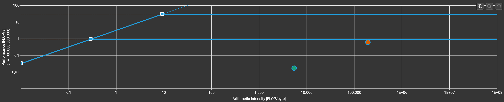
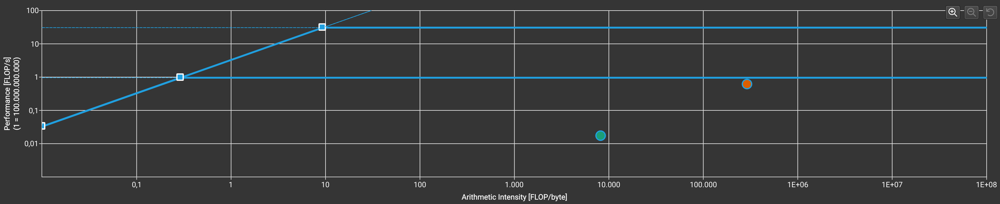
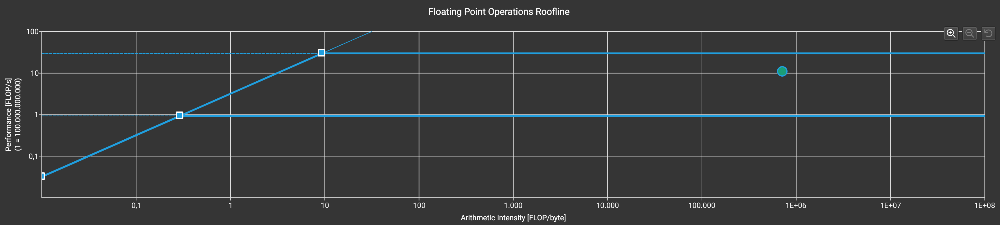
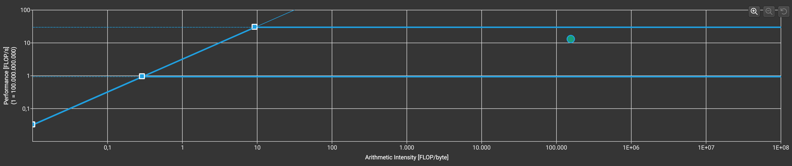
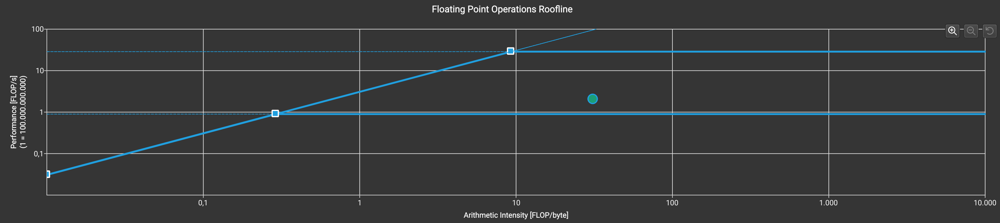
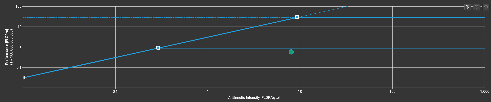
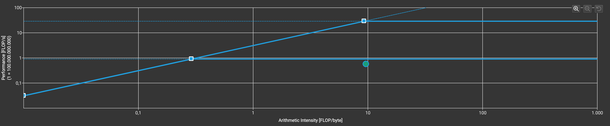

# 2D DFT Image Filtering with CUDA

How much faster can a GPU filter an image when each thread computes one Fourier coefficient? I built a sequential C implementation and ten CUDA versions to explore this question. I chose a direct two-dimensional discrete Fourier transform (DFT) because it exposes two different workloads in the same program. Each transform performs a large amount of arithmetic per output value, while the filter makes a single decision per coefficient.

On a **512 × 340** grayscale image, the CPU implementation spent **2,142.82 s** in the three processing stages. The first GPU version took **73.60 s** across the corresponding kernels. Switching to single precision brought that sum down to **2.06 s**. Later experiments showed where further work helped, and why higher occupancy or loop unrolling alone did little for this workload.

**Pietro Focaccia** · Master's degree project for the Digital Systems M course, University of Bologna · Prof. Stefano Mattoccia · Academic year 2024/25. [Official course page](https://www.unibo.it/it/studiare/insegnamenti-competenze-trasversali-moocs/insegnamenti/insegnamento/2024/468006)

[Build and run](#build-and-run) · [Algorithm](#algorithm) · [Measurements](#measurements) · [Optimization experiments](#optimization-experiments) · [Spectrum visualization](#spectrum-visualization)

## Build and run

Build from the repository root. Supply your own 8-bit binary grayscale PGM (P5) with a plain header and no comments. The programs read the paths set in each source file's `main`. The commands below assume your image is named `input.pgm`. The course benchmark used a 512 × 340 image and a cutoff radius of 260 bins.

**CPU reference**

```sh
cc -O2 -std=c11 DFTseq.c -lm -o dft-seq
mkdir -p immaginiInput
cp input.pgm immaginiInput/Bologna-512.pgm
./dft-seq
```

The CPU program writes `output_sequenziale-512.pgm`. For a quick run, use a small image. Doubling both dimensions multiplies the work of each direct transform by sixteen.

**CUDA baseline** (requires the CUDA Toolkit and a compatible NVIDIA GPU)

```sh
nvcc -O2 cuda/DFTcuda.cu -o dft-cuda
cp input.pgm Bologna-512.pgm
./dft-cuda
```

The baseline writes `output_cuda-512.pgm`. To build another experiment, substitute its source file in the compiler command. Version 9 also writes `spettro-512.pgm` and `spettro-filttrato-512.pgm`.

## Algorithm

**PGM pixels → forward DFT → circular mask → inverse DFT → output pixels.** A grayscale PGM stores one intensity per pixel, with no compression artifacts. One channel keeps the experiment focused on the transform. The implementations store the image and spectrum as one-dimensional arrays in row-major order.

Let `f(x,y)` be the intensity of the pixel in column `x` and row `y` of an image with width `M` and height `N`. The forward DFT gives one complex coefficient for each frequency index `(u,v)`:

```
F(u,v) = Σᵧ Σₓ f(x,y) · exp(−jθ)

where y = 0,…,N−1 and x = 0,…,M−1
```

Here `j` is the imaginary unit. To see how the code calculates the real and imaginary parts, define the phase for a single pixel and frequency pair:

```
θ = 2π · (u·x/M + v·y/N)
f(x,y) · exp(−jθ) = f(x,y) · [cos(θ) − j·sin(θ)]
```

The code stores the negative phase in `angle`. For each pixel, it adds `pixel * cos(angle)` to the real sum and `pixel * sin(angle)` to the imaginary sum. Since sine is odd, the second term has the minus sign shown above.

An image with `P = M·N` pixels has `P` output coefficients. Each coefficient sums `P` contributions, so the direct transform takes `O(P²)` work. The [CPU reference](DFTseq.c) computes one coefficient at a time. The GPU assigns one coefficient to each thread.

**Filter.** The mask keeps coefficients within radius 260 of array index `(floor(M/2), floor(N/2))` and sets the others to zero. The code uses the original DFT layout, where the DC coefficient is at `(0,0)`. This detail matters when interpreting the mask as a frequency filter. Each decision depends only on the index, so this stage takes `O(P)` work and needs no data exchange between threads.

The inverse transform reconstructs the image from the filtered coefficients `G`:

```
g(x,y) = (1/(M·N)) · Σᵥ Σᵤ G(u,v) · exp(+jθ)

where v = 0,…,N−1 and u = 0,…,M−1
```

For a coefficient `a+jb`, the real contribution is `a·cos(θ) − b·sin(θ)`. The implementation accumulates that component, divides by the pixel count and clips the result to the output pixel range.

## Measurements

The original course experiment used an **Intel Core i7-7700HQ**, an **NVIDIA Tesla T4**, and a **512 × 340** image. The CPU code timed each function with `clock()`. GPU times come from NVIDIA Nsight Compute and cover kernel execution. File I/O, memory allocation and transfers between the CPU and GPU are outside the comparison. The [original profiler captures](report/) are included for inspection in Nsight Compute.

| Implementation | Forward DFT | Filter | Inverse DFT | Sum of stages | CPU time / sum |
|---|---:|---:|---:|---:|---:|
| Sequential C | 1,082.51 s | 3.45 ms | 1,060.31 s | 2,142.82 s | 1× |
| CUDA baseline | 37.23 s | 7.52 µs | 36.37 s | 73.60 s | 29.1× |
| v1 · single precision | 994.90 ms | 6.88 µs | 1,070.00 ms | 2,064.91 ms | 1,038× |
| v2 · arithmetic changes | 511.33 ms | 6.88 µs | 430.67 ms | 942.01 ms | 2,275× |
| v3 · shared memory | 505.77 ms | 7.01 µs | 422.04 ms | 927.82 ms | 2,310× |
| v4 · squared distance | 505.77 ms | 6.34 µs | 422.04 ms | 927.82 ms | 2,310× |
| v5 · aligned complex values | 505.77 ms | 6.30 µs | 411.27 ms | 917.05 ms | 2,337× |

Totals and speedups here are calculated from the displayed stage times. The filter alone improved from 3.45 ms to 7.52 µs in the first GPU version, about 459×, but contributed very little to the total even on the CPU. The two transforms account for almost all of the processing time.

## Optimization experiments

### 1. Baseline and roofline analysis

The [first CUDA version](cuda/DFTcuda.cu) keeps the CPU version's double-precision complex values. Each transform thread repeatedly reads input elements, evaluates the phase and accumulates its own result. The two kernels have high arithmetic intensity, measured in floating-point operations per byte transferred. In the original roofline analysis, the double-precision points were close to the T4's double-precision compute ceiling. This suggested testing a different numerical precision before tuning memory access. [Baseline profile](report/report.ncu-rep)

**Forward DFT · double-precision baseline**



**Inverse DFT · double-precision baseline**



The pipeline views show how the work was distributed across the GPU execution units. Read these alongside the rooflines to see why changing the arithmetic was the next experiment. [Forward DFT pipeline](docs/profiling/baseline-dft-pipeline.png) · [Inverse DFT pipeline](docs/profiling/baseline-idft-pipeline.png)

### 2. Single precision, fused multiply-add, and trigonometry

[Version 1](cuda/DFTcuda1.cu) changes the complex fields and calculations to single precision. [Version 2](cuda/DFTcuda2.cu) uses fused multiply-add for repeated products and sums, and the CUDA intrinsic `__sincosf` to get the sine and cosine of the same angle in one call. The course report records no visible difference in the output image for this test. That observation is a visual comparison on one input.

| Instructions executed (millions) | v1 | v2 |
|---|---:|---:|
| Forward DFT | 70,390 | 20,233 |
| Filter | 0.21 | 0.21 |
| Inverse DFT | 71,306 | 19,771 |

The precision change produced the largest gain. The arithmetic changes then cut the combined kernel time by a further factor of about 2.2. The optimized forward transform has higher arithmetic intensity than the inverse transform. Each forward input pixel is one byte, while an inverse input coefficient contains two floats. [Single-precision profile](report/report1.ncu-rep) · [Arithmetic profile](report/report2.ncu-rep)

**Forward DFT · optimized arithmetic**



**Inverse DFT · optimized arithmetic**



### 3. Choosing the thread block size

The next experiment varied the block size in v2. Occupancy is the fraction of supported warps that are active on a streaming multiprocessor. Higher occupancy can help hide latency, but the shortest execution times here were at intermediate block sizes.

| Threads per block | DFT (ms) | Filter (µs) | Inverse DFT (ms) | DFT occupancy | Filter occupancy | Inverse DFT occupancy |
|---:|---:|---:|---:|---:|---:|---:|
| 64 | 510.72 | 10.18 | 429.31 | 88.81% | 34.97% | 89.13% |
| 128 | **510.68** | 6.91 | **429.20** | 89.92% | 61.58% | 90.13% |
| 256 | 511.33 | **6.88** | ≈430–431 | 90.11% | 67.12% | 90.18% |
| 512 | 516.49 | 7.32 | 430.98 | 92.28% | 70.72% | 91.88% |
| 1,024 | 531.00 | 8.29 | 443.24 | 96.20% | 84.22% | 96.07% |

The following versions used **16 × 8** threads for the transforms and **16 × 16** for the filter. The 64- and 128-thread DFT times differ by only 0.04 ms. The report gives no run-to-run spread, so this small difference should be read as the result of this sweep. The archived captures are in the [profiling directory](report/) under `report2*.ncu-rep`.


### 4. Shared memory and branch efficiency

In both transforms, many threads in a block read the same input values. [Version 3](cuda/DFTcuda3.cu) loads a tile into shared memory so the block can reuse it across output calculations. Loading each tile and synchronizing the threads adds work. The reported DFT time changed from 511.33 to 505.77 ms and the inverse time from 430.67 to 422.04 ms, a modest change after the arithmetic optimizations. The original block configurations also differed between these measurements.

| v3 kernel | Occupancy | Branch efficiency |
|---|---:|---:|
| Forward DFT | 90.60% | 100% |
| Filter | 67.15% | 99.98% |
| Inverse DFT | 90.23% | 100% |

The filter processes each coefficient once, so shared memory would offer little reuse. Its cutoff condition can send threads down different paths near the circular boundary. The measured branch efficiency shows this affected few warps. [Shared-memory profile](report/report3.ncu-rep)

### 5. Filter arithmetic and memory alignment

[Version 4](cuda/DFTcuda4.cu) compares the squared distance with the squared cutoff. The host squares the radius once. This removes one square root per coefficient and reduced filter time from **7.01 to 6.34 µs**. In the roofline plots below, fewer operations for the same data traffic move the arithmetic intensity to the left.

[Version 5](cuda/DFTcuda5.cu) adds eight-byte alignment to the structure that holds two floats. The profiler had identified excess memory traffic in the filter and inverse transform. Alignment lets the GPU access each complex value more efficiently. Reducing the bytes transferred raises arithmetic intensity again. The filter gained only 0.04 µs in this comparison, while the inverse DFT gained about 10.8 ms. [Squared-distance profile](report/report4.ncu-rep) · [Alignment profile](report/report5.ncu-rep)

**Filter · original distance calculation (v3)**



**Filter · squared distance (v4)**



**Filter · aligned complex values (v5)**



### 6. Loop unrolling

The final transform experiment repeated the inner loop body at three unrolling factors. The source files follow the order in which the experiments were developed. The table orders them by factor to make the comparison easier.

| Unrolling factor | Implementation | Forward DFT (ms) | Inverse DFT (ms) | DFT occupancy | Inverse DFT occupancy |
|---|---|---:|---:|---:|---:|
| Baseline | [v5](cuda/DFTcuda5.cu) | 505.54 | 411.27 | 89.95% | 90.18% |
| 2 | [v8](cuda/DFTcuda8.cu) | 505.54 | 421.64 | 89.95% | 90.21% |
| 4 | [v7](cuda/DFTcuda7.cu) | 505.54 | 421.65 | 89.95% | 90.21% |
| 8 | [v6](cuda/DFTcuda6.cu) | 505.54 | 421.65 | 89.95% | 90.21% |

Forward DFT time was the same at the precision shown in the sweep. The inverse DFT took about 10 ms longer with every unrolling factor. [Factor 2 profile](report/report8.ncu-rep) · [Factor 4 profile](report/report7.ncu-rep) · [Factor 8 profile](report/report6.ncu-rep)

## Spectrum visualization

[Version 9](cuda/DFTcuda9.cu) makes the mask easier to inspect. It writes a grayscale view of the spectrum before filtering and another after filtering. Three additional kernels turn complex coefficients into pixel intensities.

| Stage | Operation | Kernel time |
|---|---|---:|
| Magnitude | One thread calculates the magnitude of one complex coefficient. | 10.56 µs |
| Block maximum | Threads use shared memory to find the largest magnitude in each block. The CPU then combines those maxima. | 34.08 µs |
| Normalization | One thread maps one magnitude to an 8-bit intensity. | 13.06 µs |

A few large coefficients can hide weaker components on a linear scale. For magnitude `m` and maximum magnitude `m_max` in the current spectrum, the target logarithmic mapping is

```
I(m) = 255 · log(1 + m) / log(1 + m_max)
```

Outside the cutoff circle the filtered coefficients have zero magnitude. The times above describe the three GPU kernels and exclude the CPU step that combines block maxima. [Spectrum profile](report/report9.ncu-rep)
